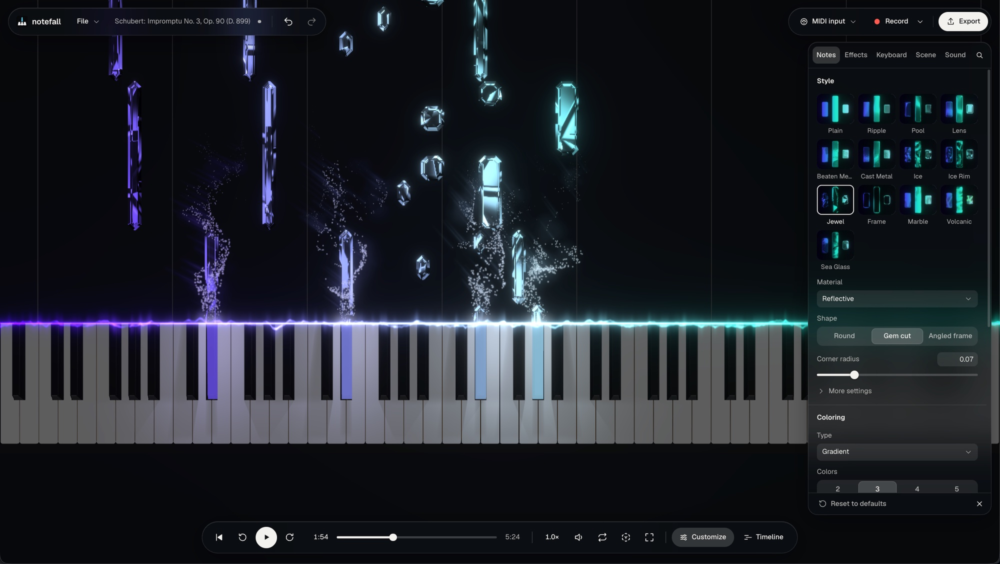

# notefall

A piano visualizer that runs in the browser. Notes from a MIDI file fall onto an
88-key keyboard as the song plays. You can also play live, record, edit notes,
change the look over time with keyframes, and export the result as video.

notefall is free to use, with no account or sign-up. All features are available
without payment, and exported videos have no watermark.

MIDI files, recordings, projects, and audio are processed in the browser and are
not uploaded. The app sends anonymous usage statistics, which can be turned off
in the app menu, and bug reports or feature requests only when you submit them.

  

  <a href="https://notefall.app">notefall.app</a>

## Features

- **Playback**: plays a MIDI file with a sampled piano and shows the notes
  falling onto a 3D keyboard, with optional glow, particles, and bloom.
- **Look**: note styles (ice, jewel, marble, metal, 2D, and others); note colors
  by track, gradient, random palette, or hand; pitch or finger labels on notes;
  settings for the hit line, particles, keyboard, camera, and background.
- **Live input**: touch, mouse, PC keyboard, or a MIDI keyboard through the Web
  MIDI API, including the sustain pedal.
- **Recording**: records live input, with an optional 4-beat count-in, and opens
  the take as an editable song.
- **Editing**: add, move, resize, split, delete, and select notes on the canvas;
  set velocity, hand, and finger for the selected notes. Undo and redo.
- **Timeline**: MIDI offset and trim, playback speed that changes over time, and
  an audio track that plays along.
- **Keyframes**: visual settings set at points on the timeline; values between
  keyframes are interpolated.
- **Virtual hands (alpha)**: 3D hands that play the song, using the hand and
  finger set on each note where there is one.
- **Export**: WAV, or MP4 (H.264) / WebM (VP9, AV1) video with or without audio;
  resolution, frame rate, and quality are configurable.
- **Projects**: saved as `.nfz` files on your own disk, with a list of recent
  files in Chrome and Edge.

## Tech stack

- Vite + React 18 + TypeScript
- [`@react-three/fiber`](https://github.com/pmndrs/react-three-fiber) + drei +
  postprocessing (Bloom) for the 3D scene
- [`smplr`](https://github.com/danigb/smplr) for sample playback,
  [`tone`](https://tonejs.github.io) for the AudioContext lifecycle
- [`@tonejs/midi`](https://github.com/Tonejs/Midi) for MIDI parse/serialize
- `react-aria-components` + Tailwind for the UI, `zustand` for state
- `mediabunny` + WebCodecs for MP4 / WebM export

## Working on the UI

The interface follows a small design system: tokens, a react-aria component kit
and rules for layout, motion and copy. Read
[`docs/design-system.md`](docs/design-system.md) before adding or changing UI.

## Credits

- Piano samples: [Salamander Grand Piano V3](https://archive.org/details/SalamanderGrandPianoV3)
  by Alexander Holm, [CC BY 3.0](https://creativecommons.org/licenses/by/3.0/)
- Hand models: [Hand Models for the Godot XR Tools](https://github.com/GodotVR/godot-xr-tools)
  by Miodrag Sejic, CC0

## License

[PolyForm Shield 1.0.0](LICENSE.md). The source is available, and any use is
permitted except offering a competing product or service.
